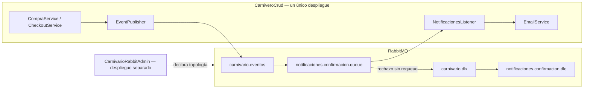

# EP3 — Evidencias de FASE 7

Fecha de ejecución: 20 de octubre de 2026, America/Santiago.

Workspace: `C:\Users\MAAXXDC\Desktop\CLOUD NATIVE\Carnivario`.
Referencia leída: `C:\Users\MAAXXDC\Downloads\PLAN_CODEX_EP3_CARNIVARIO_RABBITMQ.md`.
El alcance de esta ejecución corresponde a la solicitud específica de FASE 7: pruebas y documentación, sin cambios de producción.

## 1. Arquitectura y responsabilidades



- **Backend:** Spring Boot 3.5.7, Java 17, Spring AMQP 3.2.8. Publica y consume eventos dentro del mismo despliegue. `CompraService` produce `PENDIENTE`; `CheckoutService` produce `COMPLETADA`. `EventPublisher` prepara el contrato existente y publica después del commit cuando hay sincronización transaccional.
- **RabbitAdmin:** Spring Boot 4.0.8, Java 17. Centraliza la declaración de topología; su controller recibe HTTP, valida DTO y delega en `RabbitAdminService`, que utiliza `AmqpAdmin` y operaciones AMQP. Su API permite administrar exclusivamente recursos `demo.`.
- **Broker:** RabbitMQ 4.2.9, Docker Engine 29.0.1. Puertos publicados en loopback: AMQP 5672 y Management 15672.
- **Correo en estas pruebas:** `EmailService` simulado en la integración AMQP. Las pruebas existentes de contenido utilizan `JavaMailSender` simulado. No se utilizó Gmail.

**El productor y consumidor no son dos microservicios independientes de negocio.** Detener el despliegue completo de CarniveroCrud detiene ambos. La cola desacopla temporalmente publicación y procesamiento, pero no separa sus despliegues. RabbitAdmin no necesita permanecer ejecutándose después de declarar la topología.

## 2. Auditoría inicial y topología

Se verificó la existencia de los siete archivos solicitados:

- `backend/src/main/java/duocuc/cl/rodrigo/carniverocrud/messaging/EventPublisher.java`
- `backend/src/main/java/duocuc/cl/rodrigo/carniverocrud/messaging/NotificacionesListener.java`
- `backend/src/main/java/duocuc/cl/rodrigo/carniverocrud/messaging/RabbitConfig.java`
- `backend/src/main/java/duocuc/cl/rodrigo/carniverocrud/messaging/NotificationRetryPolicy.java`
- `backend/src/main/java/duocuc/cl/rodrigo/carniverocrud/messaging/NotificationListenerConfig.java`
- `CarnivarioRabbitAdmin/src/main/java/duocuc/cl/rodrigo/carnivariorabbitadmin/service/RabbitAdminService.java`
- `CarnivarioRabbitAdmin/src/main/java/duocuc/cl/rodrigo/carnivariorabbitadmin/controller/RabbitAdminController.java`

| Recurso | Tipo | Durable | Configuración |
|---|---|---|---|
| `carnivario.eventos` | Topic exchange | Sí | No auto-delete |
| `carnivario.dlx` | Direct exchange | Sí | No auto-delete |
| `notificaciones.confirmacion.queue` | Queue | Sí | DLX `carnivario.dlx`; dead-letter routing key `notificaciones.confirmacion.dlq` |
| `notificaciones.confirmacion.dlq` | Queue | Sí | Sin consumidor automático |

| Exchange | Routing key | Destino |
|---|---|---|
| `carnivario.eventos` | `pedido.pendiente` | `notificaciones.confirmacion.queue` |
| `carnivario.eventos` | `pedido.confirmado` | `notificaciones.confirmacion.queue` |
| `carnivario.dlx` | `notificaciones.confirmacion.dlq` | `notificaciones.confirmacion.dlq` |

El broker informa `x-queue-type=classic` en ambas colas. Se conservaron todos los argumentos originales; no se añadió TTL.

| Vhost protegido | Cola principal: inicial → final | DLQ: inicial → final | Consumidores / unacked finales |
|---|---:|---:|---|
| `/` | 0 → 0 | 0 → 0 | 0 / 0 |
| `demo.phase6.0b64596f5d1e` | 0 → 0 | 4 → 4 | 0 / 0 |

Las consultas iniciales y finales compararon nombres, tipos, durabilidad, auto-delete, argumentos, bindings y contadores. Resultado: iguales. No se consumió ni purgó ninguna de estas colas protegidas.

## 3. Suites completas de Maven

Se utilizó Maven global 3.9.11 y JDK 17.0.12. Se ejecutó `mvn -B clean test` desde cada proyecto.

| Proyecto | Total informado por Surefire | Exitosas | Fallos | Errores | Omitidas | Maven |
|---|---:|---:|---:|---:|---:|---|
| Backend | 86 | 85 | 0 | 0 | 1 | BUILD SUCCESS |
| RabbitAdmin | 77 | 77 | 0 | 0 | 0 | BUILD SUCCESS |

**No se afirma que todas las pruebas del backend hayan sido ejecutadas.** `NotificacionesDlqIntegrationTest`, de FASE 6, quedó omitida por su condición de entorno: no se definió `CARNIVARIO_DLQ_TEST_VHOST`. No se reutilizó el vhost que conserva cuatro mensajes. La integración de esta fase se ejecutó con nueve casos nuevos en un vhost distinto.

Desglose del backend:

| Clase | Exitosas | Omitidas | Alcance |
|---|---:|---:|---|
| `CarniveroCrudApplicationTests` | 2 | 0 | Contexto y registro HTTP con MockMvc/H2 |
| `HybridAuthenticationTests` | 10 | 0 | Seguridad con H2 y servidor local de claves JWT |
| `EventPublisherTest` | 10 | 0 | Unitarias: publicación, transacción y contrato |
| `NotificacionesListenerTest` | 39 | 0 | Unitarias: validación, ACK/NACK, retry, logs y conversión |
| `Phase7MessagingIntegrationTest` | 9 | 0 | Broker real, productor/listener reales, correo simulado |
| `RabbitTopologyConnectionTest` | 1 | 0 | Consulta AMQP pasiva en vhost aislado |
| `RabbitConfigTest` | 4 | 0 | Configuración y converter |
| `EmailServiceTest` | 10 | 0 | Contenido de correo y errores con JavaMailSender simulado |
| `NotificacionesDlqIntegrationTest` | 0 | 1 | Integración optativa de FASE 6 no habilitada |

Desglose de RabbitAdmin: contexto 1, topología 7, controller 34, service 35. Las pruebas de controller utilizan MockMvc; se distinguen de las peticiones HTTP reales de la sección 6. Los errores 503 se comprobaron con mocks, sin detener el broker.

Las pruebas existentes de aplicación usan H2 y un servidor JWKS local. No necesitaron MySQL ni Azure reales. Por variables exclusivas del proceso se desactivó el arranque automático de consumidores y se dirigió SMTP a `127.0.0.1:1`. La prueba AMQP inicia explícitamente su consumidor aislado y registra un mock de EmailService. No se cambiaron archivos de configuración productiva.

Evidencias locales generadas, no destinadas a versionado:

- `backend/target/surefire-reports/`: XML y TXT por clase.
- `CarnivarioRabbitAdmin/target/surefire-reports/`: XML y TXT por clase.
- `%TEMP%/carnivario-phase7-backend-tests.log`
- `%TEMP%/carnivario-phase7-admin-tests.log`
- `CarnivarioRabbitAdmin/target/phase7-rest-out.log` y `phase7-rest-err.log`

Los reportes se regeneran con Maven y `clean` los elimina. Los resúmenes anteriores registran los resultados de esta ejecución; no se inventaron capturas ni ejecuciones de Postman.

## 4. Integración real AMQP y resiliencia

Prueba nueva:
`backend/src/test/java/duocuc/cl/rodrigo/carniverocrud/messaging/Phase7MessagingIntegrationTest.java`.

Vhost exclusivo utilizado: `demo.phase7.c3c9f808aa25`. Se creó por Management; RabbitAdmin declaró allí la topología durante su prueba de contexto. Después terminó ese proceso. Las nueve pruebas AMQP verificaron que no hubiera servidor escuchando en 8082 antes de cada caso.

Se utilizó el `EventPublisher` real para ambos estados y el converter existente. El consumidor fue el listener real registrado mediante `@RabbitListener`. Un decorador del canal delegó las operaciones en el canal AMQP real y permitió verificar las llamadas ACK/NACK. La comparación del objeto recibido por el mock de EmailService y del JSON entregado comprobó la deserialización sin alterar `PedidoConfirmadoEvent`.

| Caso real | Evidencia comprobada | Resultado |
|---|---|---|
| PENDIENTE | `pedido.pendiente`, JSON y estado intactos, llamada al correo simulado, `basicAck(tag,false)` | Correcto |
| COMPLETADA | `pedido.confirmado`, JSON y estado intactos, llamada al correo simulado, `basicAck(tag,false)` | Correcto |
| Consumidor detenido/reiniciado | Mensaje retenido con cero consumidores; procesamiento y cola vacía después de reiniciar | Correcto |
| SMTP 451 transitorio | Dos envíos simulados, espera de 1 segundo, ACK final, sin DLQ nueva | Correcto |
| SMTP 451 agotado | Tres envíos simulados, esperas de 1 y 2 segundos, único NACK sin requeue, DLQ | Correcto |
| SMTP 550 | Un intento, NACK sin requeue, DLQ | Correcto |
| Autenticación SMTP rechazada | Un intento, rechazo permanente, DLQ | Correcto |
| Evento inválido seguido de válido | Inválido sin correo y con NACK; el siguiente válido se procesa y recibe ACK | Correcto |
| JSON mal formado | Rechazo antes del envío de correo; una entrega y entrada en DLQ | Correcto |

Los casos de ambos estados publicaron con cero consumidores, comprobaron la retención y luego iniciaron el consumidor. El caso de reinicio lo detuvo explícitamente entre dos mensajes. Esto demuestra la independencia temporal del consumidor y del proceso de RabbitAdmin. No equivale a haber detenido/reiniciado el despliegue completo del backend.

## 5. ACK, NACK, reintentos y DLQ

Configuración productiva existente, sin cambios en FASE 7:

```yaml
spring:
  rabbitmq:
    listener:
      simple:
        acknowledge-mode: manual
        prefetch: 1
        default-requeue-rejected: false
        retry:
          enabled: false
```

- ACK solo después de que EmailService termine correctamente.
- Validación de ID, email, estado, fecha, total e items antes del envío.
- Máximo tres intentos manuales; no se superpone retry del contenedor.
- Fallos de red reconocidos y SMTP 4xx permiten retry; autenticación, SMTP 5xx y errores desconocidos se rechazan sin retry.
- Una interrupción de la espera restaura el indicador del hilo.
- Un error del propio ACK se registra y propaga sin ejecutar NACK después.
- `ConditionalRejectingErrorHandler` rechaza errores irreversibles de conversión en modo manual. Su salida evita exponer cuerpos y causas con datos del mensaje.

Cinco mensajes alcanzaron la DLQ aislada: agotamiento SMTP 451, SMTP 550, autenticación, evento inválido y JSON inválido. Para cada uno se comprobaron el cuerpo original, identificador y:

```text
exchange de entrega = carnivario.dlx
routing key de entrega = notificaciones.confirmacion.dlq
x-death[0].reason = rejected
x-death[0].count = 1
x-death[0].queue = notificaciones.confirmacion.queue
x-death[0].exchange = carnivario.eventos
```

Se inspeccionó exclusivamente la DLQ de FASE 7 mediante lecturas puntuales `basicGet`, devolviendo sus mensajes tras inspeccionarlos. El `requeue=true` de esa devolución pertenece al código de inspección del test; el rechazo del listener fue `basicNack(tag,false,false)`. No se registró ningún consumidor automático de DLQ.

Antes de limpiar el entorno: principal 0 mensajes; DLQ 5 mensajes ready; cero unacked y cero consumidores en ambas. Los conteos permanecieron estables durante las comprobaciones; no se observó reencolado infinito ni bloqueo del mensaje válido posterior.

## 6. HTTP real y ejemplos para Postman

RabbitAdmin se inició temporalmente mediante Maven, conectado exclusivamente al vhost de FASE 7. Se verificó mediante `Get-NetTCPConnection` que escuchaba solo en `127.0.0.1:8082`. Se realizaron las siguientes 25 peticiones reales con PowerShell; todas devolvieron el código esperado.

Base URL: `http://127.0.0.1:8082/api/rabbit`.
En la tabla, `Q=demo.phase7.c3c9f808aa25.queue` y `E=demo.phase7.c3c9f808aa25.exchange`.

| # | Petición / condición | HTTP real |
|---:|---|---:|
| 1 | POST `/queues`, Q durable | 201 |
| 2 | GET `/queues/Q` | 200 |
| 3 | POST `/exchanges`, E topic durable | 201 |
| 4 | POST `/bindings`, E → Q | 201 |
| 5 | POST Q existente con durable=false | 409 |
| 6 | POST E existente con type=direct | 409 |
| 7 | POST cola con nombre vacío | 400 |
| 8 | POST cola sin durable | 400 |
| 9 | POST exchange con tipo no soportado | 400 |
| 10 | POST binding con routing key inválida | 400 |
| 11 | DELETE cola principal protegida | 403 |
| 12 | DELETE DLQ protegida | 403 |
| 13 | DELETE exchange principal protegido | 403 |
| 14 | DELETE DLX protegido | 403 |
| 15 | POST binding hacia exchange protegido | 403 |
| 16 | DELETE binding hacia cola protegida | 403 |
| 17 | POST cola fuera de `demo.` | 403 |
| 18 | GET cola inexistente | 404 |
| 19 | DELETE cola inexistente | 404 |
| 20 | DELETE exchange inexistente | 404 |
| 21 | POST binding con cola inexistente | 404 |
| 22 | DELETE `/bindings`, E → Q | 204 |
| 23 | DELETE `/exchanges/E` | 204 |
| 24 | DELETE `/queues/Q` | 204 |
| 25 | GET Q después de eliminarla | 404 |

GET verificó `name=Q`, `messageCount=0` y `consumerCount=0`.
Los errores de canal AMQP 406 durante los conflictos son esperados y se transformaron en HTTP 409. No fueron fallos de la suite.

Para repetir en Postman, provisionar un nuevo vhost aislado y arrancar RabbitAdmin con ese vhost. Usar `Content-Type: application/json`. Ejemplos de cuerpos, con nombres nuevos `demo.`:

POST `/queues`:

```json
{"name":"demo.phase7.postman.queue","durable":true}
```

POST `/exchanges`:

```json
{"name":"demo.phase7.postman.exchange","type":"topic","durable":true}
```

POST y DELETE `/bindings`:

```json
{"exchange":"demo.phase7.postman.exchange","queue":"demo.phase7.postman.queue","routingKey":"demo.phase7.event"}
```

Para 409, volver a declarar la cola con `durable=false`; para 400, enviar un nombre vacío; para 404, consultar una cola demo inexistente. La protección 403 se comprobó sobre las copias del entorno aislado. HTTP 503 tiene evidencia en `RabbitAdminControllerTest` y `RabbitAdminServiceTest` mediante mocks; no se provocó una caída del broker compartido.

AMQP no permite comprobar directamente la existencia de un binding mediante estas APIs; su eliminación conserva la semántica idempotente existente. La API verifica las referencias a cola y exchange.

## 7. Comandos de reproducción

Antes de ejecutar: crear en Management un vhost **nuevo y exclusivo** `demo.phase7.<identificador hexadecimal>` y conceder al usuario local permisos sobre él. No usar `/` ni el vhost conservado de FASE 6. RabbitAdmin creará la topología en su prueba de contexto. Mantener el puerto 8082 libre durante la suite AMQP.

Desde la raíz del workspace, en una sesión PowerShell temporal:

```powershell
$phase7 = 'demo.phase7.' + [guid]::NewGuid().ToString('N').Substring(0,12)
# Crear primero este vhost en Management y asignar sus permisos.
$localRabbit = Get-Content -LiteralPath '.env' -Raw | ConvertFrom-StringData
$env:RABBITMQ_HOST = '127.0.0.1'
$env:RABBITMQ_PORT = '5672'
$env:RABBITMQ_USER = $localRabbit.RABBITMQ_USER
$env:RABBITMQ_PASSWORD = $localRabbit.RABBITMQ_PASSWORD
Remove-Variable localRabbit
$env:SPRING_RABBITMQ_VIRTUAL_HOST = $phase7
$env:DEBUG = 'false'

Push-Location CarnivarioRabbitAdmin
mvn -B clean test
Pop-Location
# Continuar solo si Maven terminó correctamente.

$env:CARNIVARIO_PHASE7_VHOST = $phase7
$env:CARNIVARIO_RABBIT_INTEGRATION = 'true'
Remove-Item Env:CARNIVARIO_DLQ_TEST_VHOST -ErrorAction SilentlyContinue
$env:SPRING_RABBITMQ_LISTENER_SIMPLE_AUTO_STARTUP = 'false'
$env:SPRING_MAIL_HOST = '127.0.0.1'
$env:SPRING_MAIL_PORT = '1'
$env:SPRING_MAIL_TEST_CONNECTION = 'false'
Push-Location backend
mvn -B clean test
Pop-Location

# Después de terminar las pruebas AMQP, para comprobar REST:
Push-Location CarnivarioRabbitAdmin
mvn -B spring-boot:run
# Detener este proceso al finalizar las comprobaciones HTTP.
Pop-Location
```

Las variables se entregan al proceso; Spring Boot no carga automáticamente el `.env` de Docker Compose. No imprimirlas ni incorporarlas a Git. Cerrar la sesión temporal al terminar. La integración AMQP exige cola principal vacía y cero consumidores; conserva los mensajes de su DLQ hasta la limpieza del vhost.

Para revisar reportes: `target/surefire-reports/` dentro de cada proyecto. Para revisar el broker: `docker info` y `docker compose ps`. Tras conservar evidencias, eliminar exclusivamente el vhost recién creado, con sus conexiones y consumidores detenidos.

## 8. Cierre e integridad

- RabbitAdmin temporal detenido; puerto 8082 libre; sin procesos Maven/Surefire/aplicación residuales de estas pruebas.
- Recursos REST demo eliminados mediante la API.
- Vhost `demo.phase7.c3c9f808aa25` eliminado después de verificar cero conexiones, consumidores y mensajes unacked. Sus cinco mensajes eran exclusivamente de prueba.
- Vhost principal y vhost de FASE 6 conservados íntegramente, incluidos los cuatro mensajes históricos de FASE 6.
- Comparación SHA-256: los 162 archivos existentes inventariados no cambiaron. Incluye código de producción, pruebas anteriores, frontend, RabbitAdmin, POM, YAML, `.env`, `.gitignore` y Compose.
- Nuevos archivos de esta fase: este documento y `Phase7MessagingIntegrationTest.java`.
- Git conserva cambios pendientes de fases anteriores. Esta fase no modifica archivos existentes, no crea commits y no despliega.
- `git diff --check` sin errores.

## 9. Rúbrica, evidencias y límites

Correspondencia según la tabla del plan, sin atribuir una calificación:

| Indicador | Peso del plan | Evidencia disponible |
|---|---:|---|
| Nombres centralizados | 12 % | Constantes existentes y comprobación de nombres/routing en tests |
| Beans de colas/exchanges/bindings | 13 % | Tests de topología y declaración real desde RabbitAdmin |
| Configuración separada del negocio | 10 % | Clases existentes dedicadas; código productivo sin cambios |
| Consumidor por dominio | 15 % | `@RabbitListener` real de notificaciones procesando ambos eventos |
| ACK y errores | 20 % | ACK/NACK reales, retry 451, rechazo 550/autenticación/JSON, x-death en DLQ |
| REST administrativo | 13 % | 25 peticiones HTTP reales y siete códigos comprobados |
| Administración encapsulada | 10 % | Service separado, AmqpAdmin, pruebas controller/service |
| Validación de entrada | 7 % | DTO, HTTP 400/403/404/409 y pruebas automatizadas |

Pendiente o fuera de lo demostrado:

- No se ejecutaron compras/checkout exitosos de extremo a extremo contra MySQL, frontend o Azure reales. Las pruebas H2/JWT locales y la preservación del código no sustituyen esa evidencia.
- No se enviaron correos reales ni se verificó entrega efectiva en Gmail; los fallos SMTP fueron simulados.
- No se detuvo/reinició el despliegue completo de CarniveroCrud. Se detuvo/reinició su consumidor dentro del contexto de prueba aislado.
- No se probó persistencia tras reiniciar el broker, caída de Docker, AWS ni despliegue distribuido.
- No se tomaron capturas ni se ejecutó Postman; se documentaron peticiones HTTP reales reproducibles en esa herramienta.
- La separación estricta de productor y consumidor en microservicios distintos sigue sin estar implementada. La cobertura de indicadores no garantiza el 100 % de la rúbrica si se exige esa separación.
- Semántica de entrega al menos una vez: una caída después de enviar correo y antes de ACK puede duplicarlo; no hay garantía exactly-once.
- Los reintentos son acotados, pero no se configuraron nuevos timeouts SMTP. Un envío bloqueado puede demorar el procesamiento.
- La política existente del productor registra fallos AMQP y no revierte la compra; no se demostró recuperación garantizada mediante outbox o publisher confirms.
- La API administrativa continúa limitada a loopback y recursos demo, sin JWT; no se debe interpretar la prueba local como validación de exposición remota.

FASE 7 finalizada. Sin cambios productivos, commits ni despliegues. Cualquier fase posterior requiere autorización.
