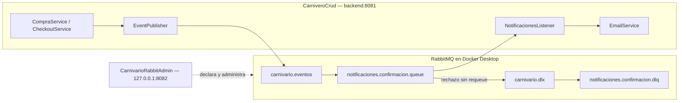

# EP3 — Carnivario y RabbitMQ

Documentación final de la implementación local, revisada el 20 de octubre de 2026.

- [Checklist de la rúbrica y rutas del código](CHECKLIST_EP3.md).
- [Evidencias técnicas de FASE 7](EP3_RabbitMQ_Fase7.md), conservadas sin cambios de contenido.
- [Preparación Docker y despliegue manual en la EC2 Back+DB — FASE 9](DESPLIEGUE_MANUAL_AWS.md).

Toda la documentación de EP3 está en `docs/EP3/`. Las rutas de código escritas en este documento parten de la raíz `Carnivario/`.

## Arquitectura implementada



**CarniveroCrud contiene el productor, el consumidor y el correo en un mismo despliegue.** RabbitAdmin es una aplicación administrativa independiente. La cola permite publicar sin consumidor y procesar después, pero no convierte al productor y al consumidor en dos microservicios de negocio separados.

`RabbitTopologyConfig` de RabbitAdmin declara la topología al iniciar mediante el `AmqpAdmin` autoconfigurado. Una vez declarada, no es necesario mantener el proceso de RabbitAdmin activo para utilizarla. El backend conserva su converter JSON y constantes, pero no declara exchanges, colas ni bindings.

No existe `CarnivarioNotificaciones/` en esta copia. No se creó un tercer servicio.

## Tecnologías verificadas

| Componente | Versión / configuración |
|---|---|
| Java | Java 17; Maven utiliza JDK 17.0.12 |
| Maven | Global 3.9.11; no se utiliza el wrapper |
| Backend | Spring Boot 3.5.7; Spring AMQP 3.2.8 |
| RabbitAdmin | Spring Boot 4.0.8; Spring AMQP existente |
| RabbitMQ | 4.2.9 verificado; imagen configurada `rabbitmq:4.2-management` |
| Docker | Docker Desktop, Engine 29.0.1 y Compose v2.40.3 verificados durante las fases locales |

La etiqueta de la imagen no fija el parche 4.2.9: esa es la versión del broker comprobado. No se modificaron versiones ni dependencias en la fase documental.

Configuración fuente: [backend/pom.xml](../../backend/pom.xml), [RabbitAdmin/pom.xml](../../CarnivarioRabbitAdmin/pom.xml), [compose.yaml](../../compose.yaml).

## Contrato de mensajería

| Recurso | Tipo | Durable | Función |
|---|---|---|---|
| `carnivario.eventos` | TopicExchange | Sí | Recibe eventos de pedidos |
| `carnivario.dlx` | DirectExchange | Sí | Recibe mensajes rechazados |
| `notificaciones.confirmacion.queue` | Queue | Sí | Consumida por NotificacionesListener |
| `notificaciones.confirmacion.dlq` | Queue | Sí | Conserva fallos para inspección |

Los exchanges no son auto-delete. La cola principal conserva:

```text
x-dead-letter-exchange = carnivario.dlx
x-dead-letter-routing-key = notificaciones.confirmacion.dlq
```

| Exchange | Routing key | Cola |
|---|---|---|
| `carnivario.eventos` | `pedido.pendiente` | `notificaciones.confirmacion.queue` |
| `carnivario.eventos` | `pedido.confirmado` | `notificaciones.confirmacion.queue` |
| `carnivario.dlx` | `notificaciones.confirmacion.dlq` | `notificaciones.confirmacion.dlq` |

No se configuró TTL ni consumidor automático de DLQ.

| Flujo existente | Estado | Publicación | Texto del correo |
|---|---|---|---|
| `CompraService.registerPurchase` | `PENDIENTE` | `publicarPedidoPendiente` → `pedido.pendiente` | Pedido recibido, todavía no confirmado |
| `CheckoutService.procesarCheckout` | `COMPLETADA` | `publicarPedidoConfirmado` → `pedido.confirmado` | Compra confirmada y completada |

Ambos utilizan el record existente [PedidoConfirmadoEvent.java](../../backend/src/main/java/duocuc/cl/rodrigo/carniverocrud/messaging/PedidoConfirmadoEvent.java), con los campos `compraId`, `emailCliente`, `fecha`, `estado`, `total` e `items`; cada item contiene `planta`, `cantidad` y `subtotal`.

`EventPublisher` prepara el evento antes del callback transaccional y publica después del commit cuando existe sincronización activa. Sin transacción, publica inmediatamente. La evidencia de mensajería y los tests del productor no equivalen a una compra completa contra MySQL/Azure reales.

### ACK, NACK y reintentos

- `acknowledge-mode=manual`, `prefetch=1`, `default-requeue-rejected=false`.
- Retry automático del contenedor desactivado; una sola política manual de hasta tres intentos totales.
- El listener valida ID, email básico, estado, fecha, total e items antes del envío.
- `basicAck(tag,false)` solo después de que EmailService termine sin excepción.
- Fallos de conexión reconocidos y SMTP 4xx pueden reintentarse, con esperas de 1 y 2 segundos.
- Autenticación rechazada, SMTP 5xx, eventos inválidos y errores desconocidos no se reintentan.
- Fallo definitivo: `basicNack(tag,false,false)` y enrutamiento por DLX hacia DLQ.
- Una interrupción durante la espera restaura el indicador del hilo y detiene los reintentos.
- Un fallo del ACK se registra y propaga, sin intentar posteriormente NACK sobre esa entrega.
- Un JSON inválido puede fallar antes del método. `NotificationListenerConfig` utiliza `ConditionalRejectingErrorHandler` con rechazo en modo manual y logs saneados.

Código: [NotificacionesListener.java](../../backend/src/main/java/duocuc/cl/rodrigo/carniverocrud/messaging/NotificacionesListener.java), [NotificationRetryPolicy.java](../../backend/src/main/java/duocuc/cl/rodrigo/carniverocrud/messaging/NotificationRetryPolicy.java), [NotificationListenerConfig.java](../../backend/src/main/java/duocuc/cl/rodrigo/carniverocrud/messaging/NotificationListenerConfig.java).

## Ejecución local en Windows

### Variables y puertos

| Variables | Uso |
|---|---|
| `RABBITMQ_USER`, `RABBITMQ_PASSWORD` | Credenciales locales de ambos procesos Java y del contenedor |
| `RABBITMQ_HOST` | Conexión Java; usar `127.0.0.1` desde Windows. Default backend `localhost`, RabbitAdmin `127.0.0.1` |
| `RABBITMQ_PORT` | AMQP; default 5672 |
| `SPRING_RABBITMQ_VIRTUAL_HOST` | Override de Spring Boot para pruebas aisladas; default `/` |
| `DB_HOST`, `DB_USERNAME`, `DB_PASSWORD` | Solo backend completo: MySQL, esquema `carnivario` |
| `JWT_SECRET` | Solo backend completo: secreto JWT proporcionado de forma privada |
| `AZURE_TENANT_ID`, `AZURE_CLIENT_ID` | Solo backend completo: issuer/audience propios de Azure; existe un default de audience en YAML |
| `MAIL_USERNAME`, `MAIL_PASSWORD` | Solo backend completo: credenciales SMTP privadas |

| Servicio | Puerto | Restricción actual |
|---|---:|---|
| Backend | 8081 | No tiene `server.address` limitado a loopback en su YAML |
| RabbitAdmin | 8082 | `server.address=127.0.0.1` |
| RabbitMQ AMQP | 5672 | Publicado por Compose en `127.0.0.1` |
| RabbitMQ Management | 15672 | Publicado por Compose en `127.0.0.1` |
| MySQL del backend completo | 3306 | Dependencia externa; no incluida en Compose |
| SMTP configurado en backend | 587 | Gmail con STARTTLS; entrega real no probada |

El Compose actual levanta únicamente RabbitMQ. La ejecución local de Java utiliza Maven global. En FASE 9 se añadió el Dockerfile de RabbitAdmin y una [guía de ejecución privada en Docker](DESPLIEGUE_MANUAL_AWS.md); sus defaults locales permanecen en `127.0.0.1:8082`.

### 1. Docker Desktop y RabbitMQ

Iniciar Docker Desktop manualmente y esperar disponibilidad del Engine. Desde `Carnivario/`:

```powershell
docker info
docker compose version
docker compose up -d rabbitmq
docker compose ps
```

Management: `http://localhost:15672`. Utilizar las credenciales locales sin publicarlas en documentación o capturas.

La raíz contiene `.env.example` con variables vacías. En una instalación nueva, preparar `.env` de forma privada antes del arranque; no sobrescribir el archivo local existente. El volumen persistente conserva datos y usuarios: cambiar `.env` no modifica automáticamente credenciales ya inicializadas. No eliminar el volumen para resolver esa diferencia.

### 2. Variables RabbitMQ para cada proceso Java

Compose carga su `.env`; Spring Boot no recibe esas variables automáticamente. En cada terminal PowerShell nueva, desde la raíz, cargar los valores únicamente en el entorno del proceso:

```powershell
$rabbitLocal = Get-Content -LiteralPath '.env' -Raw | ConvertFrom-StringData
$env:RABBITMQ_HOST = '127.0.0.1'
$env:RABBITMQ_PORT = '5672'
$env:RABBITMQ_USER = $rabbitLocal.RABBITMQ_USER
$env:RABBITMQ_PASSWORD = $rabbitLocal.RABBITMQ_PASSWORD
Remove-Variable rabbitLocal
```

Este bloque no imprime ni escribe copias de las credenciales. No ejecutar listados del entorno ni publicar salidas de Compose que interpolen secretos. Cerrar la terminal temporal al terminar. El backend tiene además `optional:file:.env[.properties]`, relativo al directorio de ejecución; esto no garantiza que lea el `.env` de la raíz al iniciarse desde `backend/`.

### 3. Iniciar RabbitAdmin

En la terminal preparada:

```powershell
cd CarnivarioRabbitAdmin
mvn -B spring-boot:run
```

Esperar el arranque y la declaración de topología. API en `http://127.0.0.1:8082`. No se necesita otro cliente RabbitMQ ni un administrador duplicado. Detener con Ctrl+C al terminar su uso.

### 4. Backend completo: ejecución condicionada

Solo después de verificar MySQL, configuración JWT/Azure y SMTP, preparar otra terminal con las variables anteriores y las dependencias propias del backend. El comando existente es:

```powershell
cd backend
mvn -B spring-boot:run
```

**Ese arranque completo no se ejecutó en FASE 8.** Inicia el consumidor real y puede procesar mensajes enviando correo. Para repetir las evidencias sin correo real, utilizar las pruebas aisladas descritas a continuación, no este comando sobre colas con datos existentes.

## Pruebas automatizadas y resultados

### Ejecución final de FASE 8

Desde una terminal temporal en la raíz, después de cargar las variables RabbitMQ:

```powershell
$env:SPRING_RABBITMQ_VIRTUAL_HOST = '/'
$env:CARNIVARIO_RABBIT_INTEGRATION = 'true'
Remove-Item Env:CARNIVARIO_DLQ_TEST_VHOST,Env:CARNIVARIO_PHASE7_VHOST -ErrorAction SilentlyContinue
$env:SPRING_RABBITMQ_LISTENER_SIMPLE_AUTO_STARTUP = 'false'
$env:SPRING_MAIL_HOST = '127.0.0.1'
$env:SPRING_MAIL_PORT = '1'
$env:SPRING_MAIL_TEST_CONNECTION = 'false'
$env:DEBUG = 'false'

cd backend
mvn -B clean test
cd ..

cd CarnivarioRabbitAdmin
mvn -B clean test
cd ..
```

Precondición de esta ejecución: broker disponible y topología original existente compatible. El backend hace una consulta pasiva optativa, sin consumir; RabbitAdmin inicializa los mismos recursos mediante declaraciones equivalentes. No se purga ni elimina ningún recurso. Las pruebas de aplicación del backend utilizan H2 y claves JWT locales. Las variables de bloqueo SMTP y de consumidores se limitan a esta terminal; no reutilizarla para arrancar el backend completo.

Resultados reales del 20/10/2026:

| Ejecución | Total Surefire | Exitosas | Fallos | Errores | Omitidas |
|---|---:|---:|---:|---:|---:|
| Backend, final FASE 8 | 85 | 76 | 0 | 0 | 9 |
| RabbitAdmin, final FASE 8 | 77 | 77 | 0 | 0 | 0 |
| Backend, evidencia histórica FASE 7 | 86 | 85 | 0 | 0 | 1 |
| RabbitAdmin, evidencia histórica FASE 7 | 77 | 77 | 0 | 0 | 0 |

Ambos comandos finales terminaron con `BUILD SUCCESS`; esto no significa que todas las integraciones se ejecutaran. Las nueve omisiones de FASE 8 son el caso de `NotificacionesDlqIntegrationTest` y ocho métodos reportados como omitidos de `Phase7MessagingIntegrationTest`. Cuando se habilita esta última clase, su método parametrizado genera dos casos y se ejecutan nueve pruebas; esto explica también la diferencia del total de Surefire.

No se alteraron tests para obtener estos resultados. No se habilitaron los entornos consumidores de FASE 6/7 durante la revisión documental. Las evidencias históricas no se presentan como nuevas ejecuciones.

Reportes actuales: `backend/target/surefire-reports/` y `CarnivarioRabbitAdmin/target/surefire-reports/`. Logs locales finales: `%TEMP%/carnivario-phase8-backend-tests.log` y `%TEMP%/carnivario-phase8-admin-tests.log`. Son artefactos regenerables, no documentación para versionar; `clean` reemplaza los reportes anteriores.

### Integraciones disponibles

| Clase | Habilitación | Alcance |
|---|---|---|
| `RabbitTopologyConnectionTest` | `CARNIVARIO_RABBIT_INTEGRATION=true` | Consulta pasiva de topología |
| `NotificacionesDlqIntegrationTest` | `CARNIVARIO_DLQ_TEST_VHOST` con prefijo `demo.phase6.` | Dos mensajes inválidos hacia DLQ aislada |
| `Phase7MessagingIntegrationTest` | `CARNIVARIO_PHASE7_VHOST` con prefijo `demo.phase7.` y sufijo hexadecimal | Ambos eventos, ACK/NACK, retry, DLQ, consumidor detenido/reiniciado |

Las integraciones consumidoras requieren un entorno exclusivo provisionado antes de ejecutarlas. No reutilizar el vhost de FASE 6 que conserva cuatro mensajes. El vhost de FASE 7 fue eliminado al finalizar esa fase. Para reproducirla, seguir la sección 7 de las [evidencias conservadas](EP3_RabbitMQ_Fase7.md) con un vhost nuevo; RabbitAdmin declara allí la topología y debe estar detenido durante las pruebas AMQP.

## API REST RabbitAdmin y Postman

URL base: `http://127.0.0.1:8082`. Cuerpos JSON con `Content-Type: application/json`. No se implementó JWT en esta API. La restricción de loopback y la política `demo.` no equivalen a autenticación.

| Método | Ruta exacta | Éxito esperado |
|---|---|---|
| POST | `/api/rabbit/queues` | 201, sin cuerpo |
| GET | `/api/rabbit/queues/{name}` | 200, estado de cola |
| DELETE | `/api/rabbit/queues/{name}` | 204 |
| POST | `/api/rabbit/exchanges` | 201 |
| DELETE | `/api/rabbit/exchanges/{name}` | 204 |
| POST | `/api/rabbit/bindings` | 201 |
| DELETE | `/api/rabbit/bindings` | 204; requiere cuerpo JSON |

Ejemplo POST `/api/rabbit/queues`:

```json
{"name":"demo.ep3.queue","durable":true}
```

Ejemplo POST `/api/rabbit/exchanges`:

```json
{"name":"demo.ep3.exchange","type":"topic","durable":true}
```

Ejemplo POST y DELETE `/api/rabbit/bindings`:

```json
{"exchange":"demo.ep3.exchange","queue":"demo.ep3.queue","routingKey":"demo.ep3.event"}
```

Ejemplo GET `/api/rabbit/queues/demo.ep3.queue`, si está vacía y sin consumidores:

```json
{"name":"demo.ep3.queue","messageCount":0,"consumerCount":0}
```

Secuencia para Postman sobre recursos nuevos: crear cola, crear exchange, crear binding, consultar cola, eliminar binding, eliminar exchange y eliminar cola. Usar únicamente recursos `demo.` propios de esa prueba; estos ejemplos no son órdenes ejecutadas durante FASE 8.

### Validaciones y errores

- Nombres obligatorios, máximo 255 caracteres, segmentos separados por puntos y caracteres alfanuméricos, guion o guion bajo.
- `durable` es booleano obligatorio para colas y exchanges.
- Tipos de exchange admitidos: `direct`, `topic`, `fanout`.
- Routing key obligatoria, máximo 255 caracteres; segmentos alfanuméricos/guion/guion bajo o comodines `*` y `#`, separados por puntos.
- Cola y exchange de un binding deben existir y tener nombres `demo.`.
- HTTP 400: DTO/JSON/formato inválido.
- HTTP 403: recurso protegido o nombre fuera de `demo.`.
- HTTP 404: cola/exchange inexistente cuando se puede determinar mediante AMQP.
- HTTP 409: configuración incompatible con un recurso existente.
- HTTP 503: broker no disponible; cubierto mediante mocks, sin detener el broker compartido.

La API bloquea operaciones sobre `carnivario.eventos`, `carnivario.dlx`, `notificaciones.confirmacion.queue` y `notificaciones.confirmacion.dlq`, incluida su vinculación a recursos demo. GET también exige nombre demo. No ofrece GET de exchanges ni listado de bindings. El borrado de bindings conserva semántica idempotente: AMQP no permite comprobar directamente su existencia mediante las APIs utilizadas.

En FASE 7 hubo **25 peticiones HTTP reales** correctas con 200/201/204/400/403/404/409. Se realizaron con PowerShell; se documentan para reproducción en Postman, sin afirmar que se ejecutó Postman o que existen capturas.

## Seguridad y conservación

- `.env` está ignorado por Git; `.env.example` puede versionarse y contiene valores vacíos.
- RabbitAdmin declara `127.0.0.1:8082`; Compose publica 5672 y 15672 solo en loopback.
- No se incluyeron credenciales reales, JWT operativos ni datos personales reales en los documentos nuevos.
- La revisión de tests encontró **contraseñas ficticias de fixtures, valores sintéticos para probar saneamiento y JWT generados en ejecución con claves de prueba**. Por tanto, la condición literal «ningún token ni contraseña en tests» no se cumple. No se identificaron credenciales reales en lo revisado ni se modificaron esos tests.
- Los ejemplos administrativos usan exclusivamente nombres `demo.`.
- No se consumieron mensajes originales ni los cuatro conservados en la DLQ de FASE 6.
- No se modificaron producción Java, POM, YAML, Compose, `.env`, frontend, seguridad, tests existentes ni README general.

## Limitaciones y revisión antes de AWS

1. Confirmar con el docente si la rúbrica exige despliegues separados de productor y consumidor. Actualmente ambos pertenecen al backend.
2. Completar pruebas de compra/checkout contra MySQL y Azure reales. Las pruebas H2/JWKS locales no sustituyen esa integración.
3. Planificar una validación SMTP autorizada y controlada: no se probó Gmail real ni se enviaron correos en estas fases.
4. Resolver, con autorización para código/configuración, timeouts SMTP e idempotencia del correo: una caída después de enviar y antes de ACK puede causar duplicados.
5. Revisar la recuperación ante fallos de publicación. El productor registra el fallo sin revertir la compra; no hay evidencia de recuperación garantizada mediante outbox o publisher confirms.
6. Revisar autenticación y respaldo antes de ampliar el acceso al administrador. La guía de FASE 9 prepara su ejecución por red Docker y loopback con secretos externos; no se ha desplegado en AWS ni se ha añadido autenticación a la API.
7. Validar reinicios del broker y del despliegue completo en un entorno controlado. La evidencia disponible cubre reinicio del consumidor de prueba.

No se asigna una nota estimada ni se afirma cumplimiento del 100 %. Los resultados de tests de este documento corresponden a FASE 8; la preparación posterior se describe en la guía de FASE 9 y no constituye un despliegue AWS.

## Organización documental y cierre

```text
docs/EP3/
├── README_EP3.md
├── CHECKLIST_EP3.md
├── DESPLIEGUE_MANUAL_AWS.md
└── EP3_RabbitMQ_Fase7.md
```

El documento de FASE 7 se trasladó desde `docs/` sin cambios de bytes, comprobado con SHA-256. No había referencias documentales entrantes a su ruta anterior; se añadieron enlaces relativos desde los dos documentos nuevos. El resto de documentos y el README general se conservaron.

La documentación de FASE 7 registra su estado histórico: sus rutas de reportes `target/` son regenerables y no deben confundirse con los resultados finales de FASE 8. El broker sigue healthy, sin procesos temporales de prueba. `git diff --check` pasó; los cambios previos del workspace permanecen pendientes. Sin commits ni despliegues.
